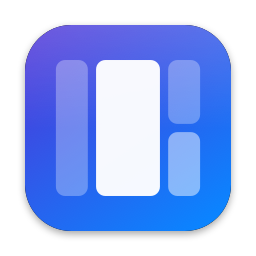
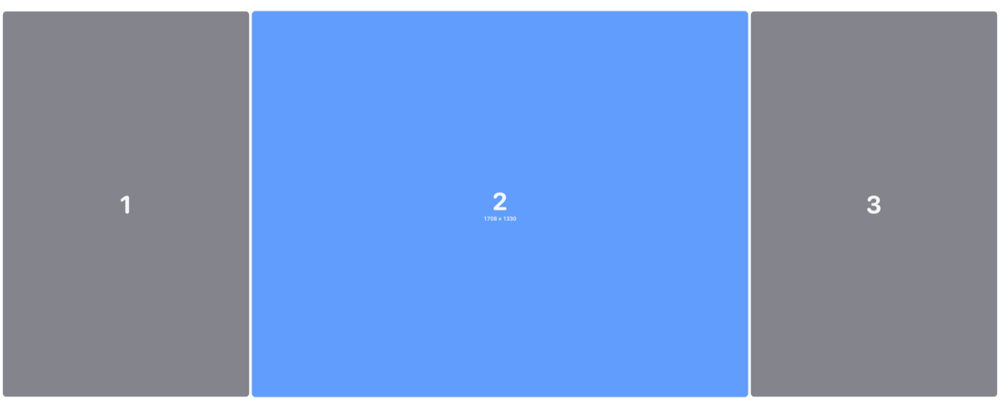
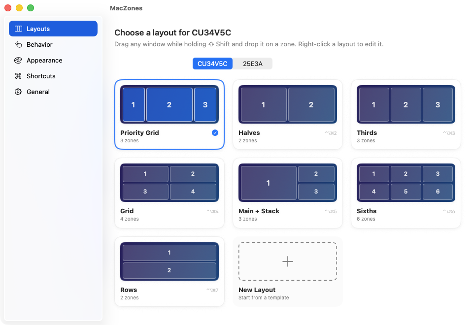
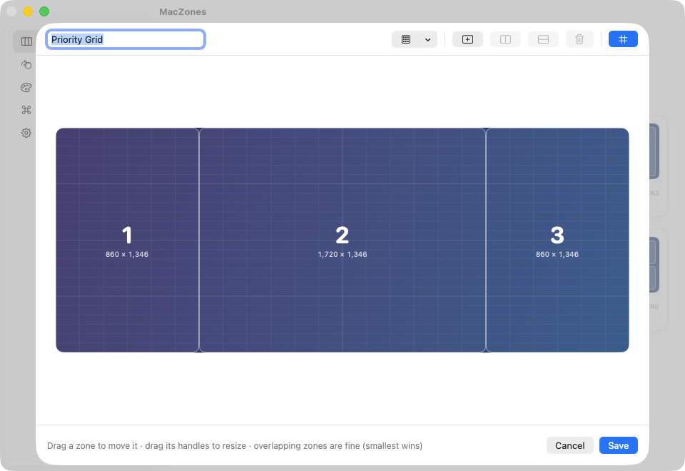
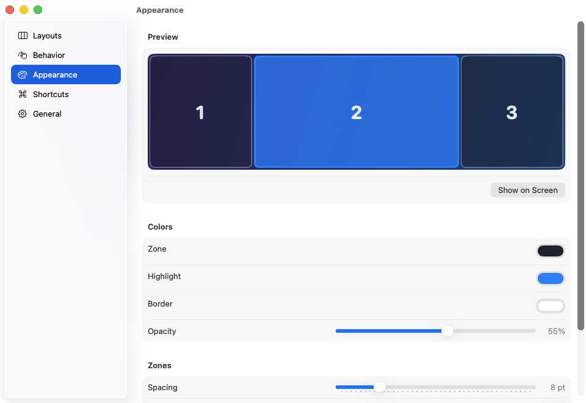
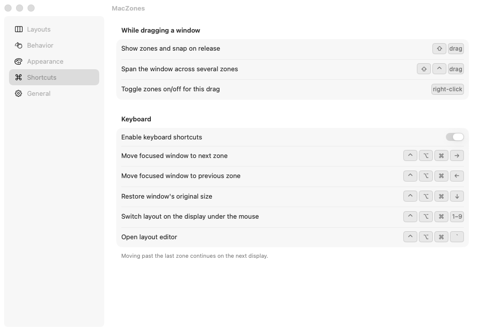

<p align="center">
  
</p>

<h1 align="center">MacZones</h1>

<p align="center">
  FancyZones-style window snapping for macOS.<br>
  Hold <kbd>⇧ Shift</kbd> while dragging a window, drop it on a zone, done.
</p>

<p align="center">
  
</p>

## Features

- **Drag to snap.** Hold a modifier (⇧ by default; ⌃, ⌥ or ⌘ also work) while dragging any window and a zone overlay appears. Release over a zone and the window fills it.
- **Span zones.** Add ⌃ while dragging to stretch a window across several zones, or turn on proximity mode to grab neighbouring zones near an edge.
- **Per-display layouts.** Each monitor remembers its own layout. Seven built-in layouts: Priority Grid, Halves, Thirds, Grid, Main + Stack, Sixths, Rows.
- **Layout editor.** Start from a template (columns, rows, grid, priority grid, main + stack), then move, resize, split and add zones on a canvas with snap-to-grid. Overlapping zones are allowed.
- **Restore on unsnap.** Drag a snapped window out of its zone and it gets its original size back.
- **Keyboard control.** ⌃⌥⌘ ←/→ moves the focused window between zones (and across displays), ⌃⌥⌘ ↓ restores its size, ⌃⌥⌘ 1–9 switches layouts.
- **Your colours.** Zone, highlight and border colours, opacity, spacing and zone numbers are all configurable.
- Lives in the menu bar, launches at login if you want, ~2 MB download, no dependencies.

| Layouts | Editor |
|---|---|
|  |  |
| **Appearance** | **Shortcuts** |
|  |  |

## Install

### Homebrew

```bash
brew tap tralots/maczones https://github.com/tralots/MacZones
brew install --cask maczones
```

Then open MacZones and grant **Accessibility** access when asked. Update with `brew upgrade --cask maczones`.

### Download

1. Grab `MacZones-x.y.z.zip` from [Releases](../../releases/latest) and unzip it.
2. Move `MacZones.app` to `/Applications` and open it.
3. The build is not notarized, so macOS blocks the first launch. Go to **System Settings → Privacy & Security** and click **Open Anyway**. (Or run `xattr -dr com.apple.quarantine /Applications/MacZones.app`.)
4. Grant **Accessibility** access when asked (System Settings → Privacy & Security → Accessibility). MacZones needs it to move other apps' windows; the settings window updates as soon as it's granted.

Requires macOS 14 Sonoma or later. Universal binary (Apple silicon + Intel).

### Build from source

```bash
git clone https://github.com/tralots/MacZones.git
cd MacZones
scripts/build.sh install   # builds, copies to /Applications, launches
```

Needs Xcode (or the Swift toolchain) 5.10+. The script signs with your first "Apple Development" identity if you have one, otherwise ad-hoc. With ad-hoc signing macOS asks for Accessibility again after every rebuild.

## Usage

| Do this | Get this |
|---|---|
| ⇧ + drag a window | Show zones, snap on release |
| ⇧ ⌃ + drag across zones | Snap over all zones between start and cursor |
| Right-click while dragging | Toggle zones for this drag |
| Drag a snapped window (no ⇧) | Unsnap and restore original size |
| ⌃⌥⌘ → / ← | Move focused window to next / previous zone |
| ⌃⌥⌘ ↓ | Restore focused window's original size |
| ⌃⌥⌘ 1–9 | Switch layout on the display under the mouse |
| ⌃⌥⌘ ` | Open the layout editor |

Pick layouts per display from the menu bar icon or **Edit Layouts…**. Right-click a layout card to edit, duplicate, reorder or delete it.

> **Tip:** macOS 15+ uses ⌥ while dragging for its own tiling. If you choose ⌥ as the activation key, turn off *Drag windows to screen edges to tile* in System Settings → Desktop & Dock.

## How it works

- A global mouse monitor watches for drags. On the first drag event MacZones asks the Accessibility API which window is under the cursor and treats the drag as a window move once that window's position changes while its size stays the same.
- Zones are stored as normalized rectangles per layout and mapped onto each display's visible frame (menu bar and Dock excluded), with configurable spacing.
- Snapping sets the window's size, position and size again through the Accessibility API, which handles moves between displays of different sizes.
- Settings live in `~/Library/Application Support/MacZones/config.json`.

## Development

```bash
swift build               # compile
swift test                # unit tests (zone geometry, templates, decoding)
scripts/build.sh run      # build the .app and launch it
scripts/build.sh release  # universal build zipped into build/
scripts/e2e.sh            # end-to-end test with real synthesized input (moves your mouse for ~5 s)
```

Architecture notes and macOS gotchas are in [CLAUDE.md](CLAUDE.md).

## Similar apps

[MacsyZones](https://macsyzones.com) (free, open source), [Smart Layouts](https://alternativeto.net/software/smart-layouts/about) (paid), [Moom](https://manytricks.com/moom/) and [Rectangle](https://rectangleapp.com) cover similar ground. Use whichever fits.

## License

[MIT](LICENSE). Not affiliated with Microsoft; FancyZones is part of Microsoft PowerToys.
